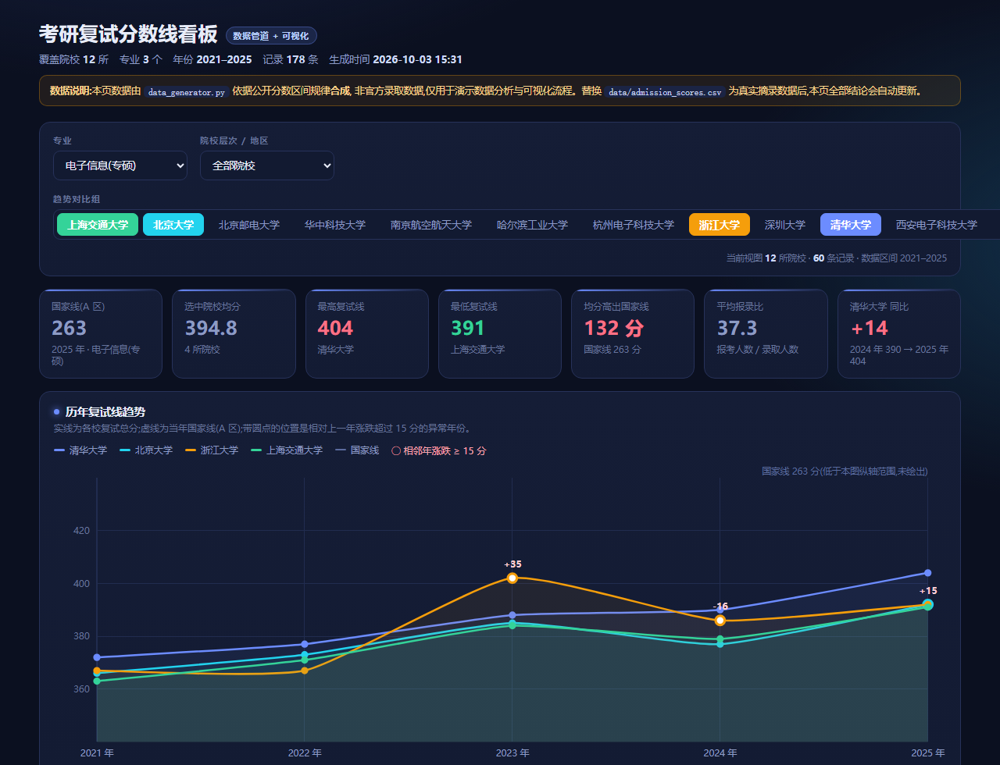

# 考研复试分数线看板

**把 12 所院校 · 3 个专业 · 5 年的复试分数线,做成一个零依赖、单文件、双击就能打开的交互式看板。**



不用 `pip install`,不用起本地服务器,不用联网。`dashboard.html` 就是一个完整的产品:
打开它就能筛选专业、对比院校趋势、看 2026 年外推预测、输入自己的分数看能进哪些学校的复试。

> ⚠️ **数据说明**:仓库内的数据由 `data_generator.py` 依据公开的分数区间规律**合成**,**不是**官方录取数据,
> 仅用于跑通数据管道与可视化。合成公式完整写在 `data_generator.py` 里,任何人重跑都能得到逐字节相同的结果。
> 把 `data/admission_scores.csv` 换成人工摘录的真实数据后,看板全部结论会自动更新,无需改代码。

---

## 快速开始

```bash
python data_generator.py     # 1. 生成数据集 -> data/admission_scores.csv(178 行,自带质量自检)
python build_dashboard.py    # 2. 把数据注入模板 -> dashboard.html(单文件,94 KB)
```

然后用浏览器打开 `dashboard.html`。**没有第三步,没有任何依赖。**

可选的自检(改完代码后建议跑一遍):

```bash
node check_js.js             # 产物内联脚本的语法冒烟测试(挡白屏)
node verify_dashboard.js     # 21 项断言:数据契约 / 算法复算 / DOM id 契约 / 零外部依赖
```

---

## 它到底解决了什么问题

考研择校时,分数线散落在各校研究生院官网的公告里:有的是 PDF,有的是网页表格,
字段名各不相同,想看"我这个分数在哪些学校有戏"只能一个个手动翻,还容易看错年份。

这个项目做三件事:

1. **归一化** —— 把不同来源的分数线压进同一张表(15 个字段),之后所有分析都基于这张表;
2. **可比较** —— 同一专业下横向比较各校分数线、报录比,以及和国家线的差值;
3. **可决策** —— 输入自己的总分和单科分,直接给出"能进复试的院校清单",并标出压线风险。

---

## 功能

| 模块 | 说明 |
|---|---|
| 筛选 | 按专业、院校层次(985/211/双非)、地区过滤;最多同时对比 6 所院校 |
| 指标卡 | 国家线、选中院校均分、最高/最低复试线、均分超出国家线幅度、平均报录比、同比 |
| 趋势图 | 各校历年复试线折线对比,自动标注**相邻年涨跌 ≥ 15 分**的异常年份 |
| 排名图 | 最新一年各校复试线横向排名,标出自划线院校与国家线基准 |
| 预测图 | 对每所院校做**最小二乘线性回归**,外推下一年分数并给出 ±20% 历史波幅区间 |
| 分数匹配器 | 输入总分 + 单科分,按最新一年分数线筛选可进复试的院校,校验国家线与单科线 |
| 明细表 | 全部记录,支持点击表头排序,含自动生成的同比备注 |

---

## 项目结构

```
kaoyan-dashboard/
├── data_generator.py            # 数据生成 + 质量自检(仅标准库)
├── build_dashboard.py           # CSV -> 单文件 HTML(构建期数据注入)
├── assets/
│   └── dashboard_template.html  # 页面模板(占位符 /*__DATA__*/ 在此被替换)
├── data/
│   └── admission_scores.csv     # 数据集,178 行
├── dashboard.html               # ← 最终交付物:零依赖单文件看板
├── check_js.js                  # 语法冒烟测试
├── verify_dashboard.js          # 21 项自动化断言
└── preview/                     # 截图
```

数据流:

```
data_generator.py ──> data/admission_scores.csv ──> build_dashboard.py ──> dashboard.html
   (合成/清洗)            (中间表示,可人工替换)         (类型转换+注入)        (自包含产物)
```

---

## 五个值得讲的技术决策

这一节是给面试准备的:每个决策都有**具体的失败现象**作为依据,不是"我觉得这样比较好"。

### 1. 为什么把数据"注入"HTML,而不是让页面去读 CSV?

**踩的坑**:最初的版本用 `fetch('data/admission_scores.csv')` 读数据,结果直接双击打开
`dashboard.html` 时页面白屏 —— 浏览器的同源策略在 `file://` 协议下会拦截本地文件读取(CORS)。

**决策**:在构建期用 `build_dashboard.py` 把数据内联进 HTML。

**收益**:产物是**一个文件**,可以当附件发邮件、可以直接交给导师、断网也能跑。
这对"要发给别人看"的场景是决定性的。

**代价**:数据变了必须重新构建一次。对这个规模的项目完全值得 ——
一个 94 KB 的文件比"请先装 Python 再跑脚本"的交付方式友好太多。

### 2. 为什么坚持做类型转换,而不是直接 `json.dumps`?

**踩的坑**:CSV 里一切都是字符串。如果直接把 `"380"` 塞进 JSON,
JS 里比较 `"380" < "1000"` 会按**字典序**得到 `false` ——
排序和分数筛选会静默地全部出错,而且不报任何异常。

**决策**:在 `build_dashboard.py` 的 `FIELDS` 表里为每一列显式声明目标类型,
转换失败直接终止构建并指出出错行号。

**收益**:错误在构建期暴露,而不是等用户点开页面才发现数字是乱的。
`verify_dashboard.js` 里专门有一条断言守这个契约。

### 3. Y 轴定标:一个把图表毁掉的细节

**踩的坑**:折线图最初按"所有数值的最小值到最大值"定标,而国家线(约 263)远低于院校线(约 360–405),
于是 Y 轴被拉成 240–440,几条院校线被压成一条几乎水平的糊线 —— **趋势完全看不出来**。

**决策**:Y 轴只按院校复试线定标;国家线若落在范围外,不绘制它,而在图下注明
"国家线 263 分(低于本图纵轴范围,未绘出)"。

**收益**:同样的数据,纵轴从 240–440 收紧到 360–420 后,校际差异和年度波动立刻清晰。
**教训:可视化里"全部显示"往往等于"什么都看不清",要敢于主动省略并说明。**

### 4. 标签去重叠:图表库帮你做的事,手写 SVG 就得自己做

**踩的坑**:预测图右端,4 所院校的 2026 预测分只差几分(409/404/397/395),
按各自的 y 坐标画标签会**糊成一团完全不可读**。

**决策**:加一个最小间距(16px)的去重叠算法 —— 按 y 排序后依次向下推开,
若整体越界则整体上移,并给被推开的标签补一条引线指向它对应的数据点。

### 5. 数据自检:让脚本自己发现"看起来假"的数据

`data_generator.py` 结尾的 `quality_check()` 会检查:主键唯一性、分数区间、
**非自划线院校不得低于国家线**、报录人数一致性、以及相邻年份跳变超过 25 分的可疑记录。

它真实地抓到了问题:早期版本的抖动随机数只按 (学校, 专业) 播种,
导致同一所学校连续两年涨幅都是 `+0`,一眼假 —— 这是个隐蔽的 bug,
是自检帮我在"合成了一个数据集"和"合成了一个像样的数据集"之间划出了界线。

另外,数据集里**故意保留**了两个异常点(浙江大学 2023 年 +35 分、深圳大学 2024 年 +35 分),
用来验证看板的异常检测逻辑真的能触发。它们记录在 `data_generator.py` 的 `OVERRIDE` 表里,不是 bug。

---

## 已知限制

诚实地写清楚边界,比假装没有边界更可信:

- **数据是合成的。** 见文首说明。换成真实数据只需替换 CSV,代码不用动。
- **回归预测只是统计外推。** 5 个数据点做线性外推,置信度很低;
  分数线还受招生计划、报考人数、试题难度影响,这些变量模型里都没有。
  看板上明确标注了"不构成报考建议"。
- **年份样本偏少。** 少于 3 个年份的组合会被判定为"样本不足"而跳过预测。
- **未做数据抓取。** 目前数据靠脚本合成,真实数据的采集(爬虫 + 人工校验)是下一步。
- **渲染方式是手写 SVG。** 好处是零依赖、可控;代价是没有现成图表库的交互能力
  (缩放、框选、导出图片)。

## 关于 AI 辅助

本项目的**代码在 AI 辅助下完成**,架构设计、模块划分、
技术选型(单文件注入 / 类型转换表 / Y 轴定标策略)和全部调试决策由我做出。
所有数据来源于公开信息或由脚本合成,不含任何非公开数据。
这类标注我认为应当写进 README —— 展示"知道自己在做什么、以及为什么这样做",
比假装代码全部手写更有价值。

---

## 下一步可以做什么

- 接入真实数据:对 3–5 个结构稳定的院校官网写抓取脚本,加限速与去重
- 引入更多变量做预测:招生计划人数、报考人数、试题难度指数,把线性回归换成多元回归
- 增加"调剂"模块:按分数和专业匹配有调剂名额的院校
- 导出功能:一键把筛选结果导成 Excel,方便线下对比
